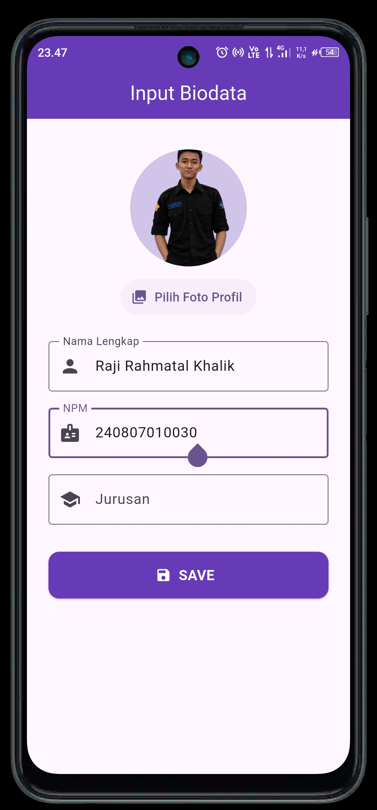
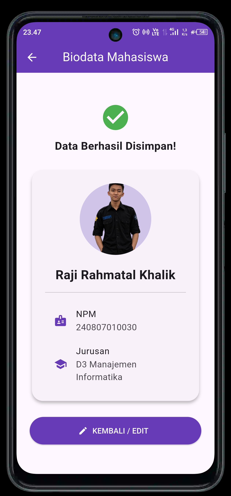

# Aplikasi Profil Biodata Mahasiswa

Aplikasi Flutter sederhana untuk memasukkan dan menampilkan biodata mahasiswa dalam dua halaman.

## Tampilan Aplikasi

### 1. Halaman Input Data

Pengguna dapat memilih foto profil, mengisi nama lengkap, NPM, dan jurusan, lalu menekan tombol **SAVE**.

<p align="center"></p>

### 2. Halaman Data Mahasiswa

Setelah data dikirim, aplikasi menampilkan konfirmasi bahwa data berhasil disimpan beserta foto dan biodata yang dimasukkan. Tombol **KEMBALI / EDIT** membawa pengguna kembali ke halaman input.

<p align="center"></p>

## Fitur

- Memilih foto profil dari perangkat.
- Mengisi nama lengkap, NPM, dan jurusan.
- Berpindah dari halaman input ke halaman hasil.
- Menampilkan ringkasan biodata pada halaman hasil.
- Kembali ke halaman input untuk mengedit data.

## Teknologi

- **Flutter** dan **Dart**
- **image_picker** untuk memilih foto dari galeri/perangkat
- **Material Design** untuk komponen antarmuka

## Struktur Proyek

```text
lib/
├── main.dart
└── pages/
    ├── input_page.dart
    └── output_page.dart
```

## Menjalankan Proyek

Pastikan Flutter SDK dan perangkat Android Emulator atau perangkat Android sudah tersedia.

```bash
flutter pub get
flutter run
```

## Catatan

Data biodata pada versi ini diteruskan dari halaman input ke halaman hasil selama aplikasi berjalan. Penyimpanan permanen ke database atau penyimpanan lokal belum termasuk dalam versi ini.
